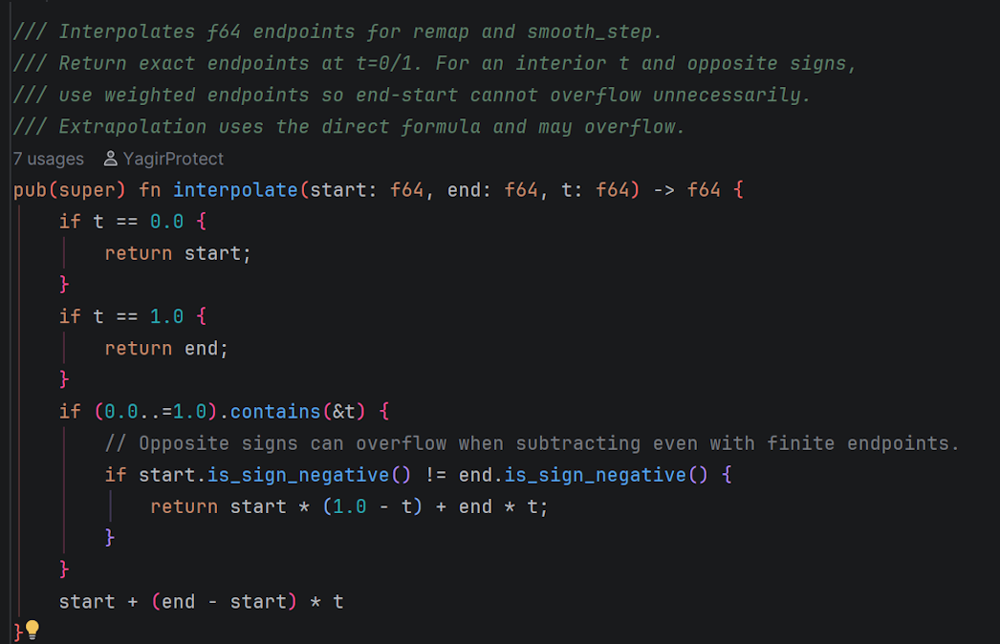
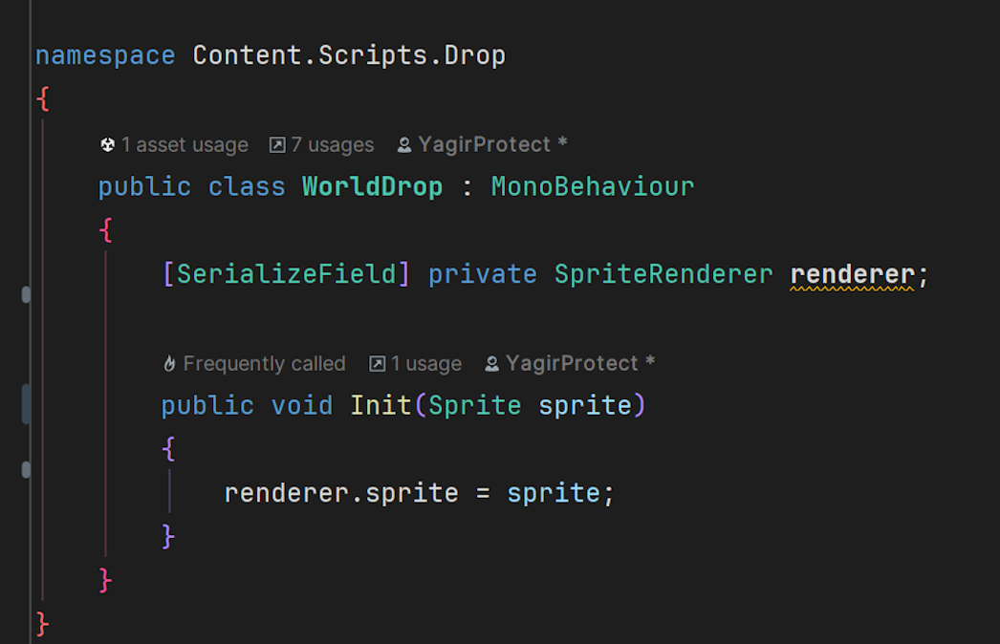
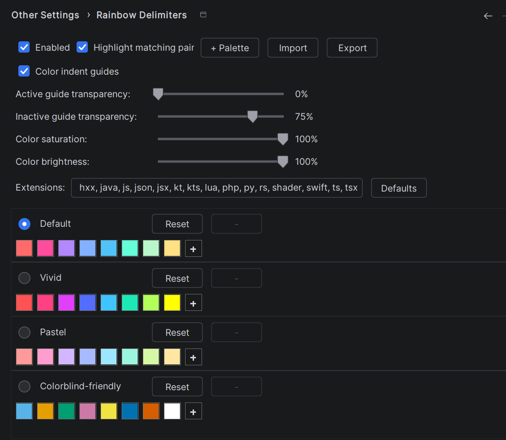

<table>
  <tr>
    <td width="110">
      
    </td>
    <td>
      <h1>
        <a href="https://plugins.jetbrains.com/plugin/29914-free-rainbow-brackets-delimiters">
            Free Rainbow Brackets (Delimiters)
        </a>
      </h1>
      <p>
        <b>Simplest delimiter coloring free!</b> Rainbow coloring for <code>()</code>, <code>[]</code>, <code>{}</code>
        based on nesting level. Works in RustRover, Rider, and other IntelliJ-based IDEs.
      </p>
    </td>
  </tr>
</table>

A lightweight alternative to paid “rainbow brackets” plugins: it colors matching brackets by nesting depth so you can read deeply nested code faster.

## Screenshots

<p align="center">
  
  
</p>


## What's new in 1.9.2

- Adjust **saturation and brightness** from 0% to 100%. Both default to 100%, keeping existing palette colors unchanged.
- Preview adjustments **directly in every palette's color squares** while moving the sliders. Apply saves the changes and refreshes open editors.
- Color guides for multiline **`{}`, `()` and `[]`**, including function parameters, nested calls and arrays.
- Ordinary theme-gray guides for **`case/default` branches without braces** in C#, C and C++, including C# `when` conditions and nested switches.
- Continuous guides through **Code Vision hints**, with device-pixel alignment at fractional display scales and native guide replacement in Rider and split editors.
- Expanded default file extensions for **C++ modules and GLSL shaders**. Existing saved extension selections are preserved; use **Defaults** beside **Extensions**, then **Apply**, to load the expanded set.
- Settings now record the plugin version that last saved them, providing a starting point for future migrations. Existing settings without that field have an unknown origin; this release does not automatically expand saved extension selections.

## Features

- Rainbow coloring for `()`, `[]`, `{}` by **nesting level**
- Skips **strings** and **comments** when possible (lexer-based; falls back to a manual parser where needed)
- Lightweight: highlights only the **visible area** (plus a small margin)
- Caches delimiter scans per document version to reduce scroll overhead
- Enable/disable toggle in **Settings → Rainbow Delimiters**
- Editable supported file extensions, so you choose where the plugin runs
- Editable palettes with custom names for user-created palettes
- Add, remove, reset, import, and export palette sets
- Dynamic color count: add or remove color swatches directly in the palette
- Click a color square to open the color picker; right-click a color square to remove it
- Optional matching pair emphasis based on cached delimiter pairs
- Indent guides for multiline `{}`, `()` and `[]` pairs in the matching bracket color (enabled by default)
- Gray indent guides for `case/default` sections without braces in C#, C and C++, including C# `when` guards; stacked labels share a guide and explicit brace blocks keep their colored guide
- Inactive colored guides use 75% transparency by default and are mixed with 20% neutral gray. The active pair uses its own transparency setting, defaulting to 0%.
- Vertical guide lines align with the center of the brace column and follow editor font size and zoom
- Colored guides replace the corresponding native gray guides and use the IDE's stroke thickness, including HiDPI; other native guides remain available
- Built-in palettes plus custom palette copies
- Saturation and brightness sliders with live previews directly in all palette color squares, following the current IDE theme

## Supported IDEs

This is a plain IntelliJ Platform plugin (editor-level highlighting), so it can work in many JetBrains IDEs:

- RustRover
- Rider
- IntelliJ IDEA / CLion / WebStorm / etc.

Compatibility is controlled by the **build number range** injected into `plugin.xml` during build (`sinceBuild` / `untilBuild` in `intellijPlatform.pluginConfiguration.ideaVersion`). Current build range is `251` through `262.*`, covering 2025.1 through 2026.2.

## Settings

Open **Settings → Rainbow Delimiters** to configure:

- **Enabled**: turns all plugin highlighting on or off.
- **Highlight matching pair**: underlines the bracket pair near the caret without rescanning the file, leaving the caret visible between adjacent brackets.
- **Color indent guides**: draws vertical guides inside multiline `{}`, `()` and `[]` pairs using the same palette color as the brackets, including multiline parameter lists and arrays. Also supplies missing guides for `case/default` sections without braces in C#, C and C++; these use the theme's ordinary indent guide color. Enabled by default; turn it off to keep the IDE's usual guides. Apply updates open editors.
- **Active / Inactive guide transparency**: independent sliders from 0% (fully visible) to 100% (invisible). Active means a brace is selected or next to a caret. Defaults: 0% active, 75% inactive. Values are saved and applied to open editors with Apply.
- **Extensions**: comma-separated file extensions where the plugin should run. The **Defaults** button restores the current default list; press **Apply** to save it.
- **Palettes**: select active palette, duplicate palettes, rename custom palettes, reset built-in palettes, and delete custom palettes.
- **Colors**: click a color square to edit it, use the `+` square to add a color, or right-click a color square to remove it.
- **Color saturation / brightness**: relative controls from 0% to 100%; both default to 100%, preserving the original palette. Zero saturation makes colors grayscale, and zero brightness makes them black. All palette color squares preview unsaved adjustments immediately using the current IDE theme; Apply updates brackets and their colored guides in open editors. Raw palette colors and palette JSON are preserved.
- **Import / Export**: save or load palette sets as JSON.

Moving the saturation and brightness sliders updates only the palette previews until **Apply** is pressed. **Reset** restores the saved settings, and closing the dialog with **Cancel** discards unsaved changes. Applied settings persist after restarting the IDE. The color sliders and transparency controls affect colored bracket guides; `case/default` guides retain the IDE theme's ordinary guide color.

## Supported file types

The default extension list includes:

- Rust: `.rs`
- C#: `.cs`
- JVM: `.java`, `.kt`, `.kts`
- C/C++: `.c`, `.h`, `.cc`, `.cpp`, `.cxx`, `.hpp`, `.hh`, `.hxx`, `.ixx`, `.mxx`, `.cppm`, `.ccm`, `.cxxm`, `.c++m`
- GLSL: `.glsl`, `.vert`, `.vsh`, `.tesc`, `.tese`, `.geom`, `.gsh`, `.frag`, `.fsh`, `.comp`
- JS/TS: `.js`, `.ts`, `.jsx`, `.tsx`
- Other: `.py`, `.go`, `.swift`, `.lua`, `.json`, `.hlsl`, `.shader`, `.php`

To customize: open **Settings → Rainbow Delimiters** and edit the supported extensions list.

Updates preserve a previously saved list. To enable all newly added default extensions, click **Defaults** beside **Extensions** and then **Apply**.

## Installation

### From JetBrains Marketplace

If/when the plugin is published, install it from **Settings → Plugins → Marketplace** and search for **Free Rainbow Braces**.

### From ZIP (local install)

1. Build the plugin ZIP (see “Build” below).
2. In your IDE: **Settings → Plugins → ⚙ → Install Plugin from Disk…**
3. Select the generated ZIP and restart the IDE.

## Development

See [Code structure and settings API](docs/ARCHITECTURE.md) for package responsibilities, editor resource ownership, immutable settings snapshots, palette editing and test layout.

Use **JDK 25** to build and run tests against the 2026.2 platform. The plugin emits Java 21 bytecode and uses Kotlin 2.1 APIs for compatibility with IDEs starting at 2025.1; Kotlin's standard library is provided by the IDE.

`targetIde` selects `idea` (default), `rider`, or `rustrover`. Local installation paths are configured in `gradle.properties`; override any of them with `-PlocalIdePath=...`. Without a valid local path, Gradle downloads the configured 2026.2 release of the selected product. Run the platform fixture tests on IntelliJ IDEA; Rider's test environment requires its own solution/backend fixtures.

```bash
./gradlew test -PtargetIde=idea
```

Verify binary compatibility with the selected IDE (add `-PverifyOldestIde` to also check 2025.1):

```bash
./gradlew verifyPlugin -PtargetIde=idea -PverifyOldestIde -x buildSearchableOptions
```

Add `-PverificationIdePath="/path/to/another/ide"` to verify another installed product, such as Rider, in the same run.

### Run in a sandbox IDE

`runIde` starts a separate IDE instance (sandbox) with your plugin already loaded.

- From IntelliJ: run the Gradle task **`runIde`**
- Or from terminal:

```bash
./gradlew runIde
```

Then open any supported file (e.g., `test.rs`, `test.cs`) and type nested code to see the coloring.

### Build a distributable ZIP

```bash
./gradlew buildPlugin -x buildSearchableOptions
```

Output ZIP:

```
build/distributions/*.zip
```

> [!NOTE]
>- Rider C# editor is special (ReSharper backend). Some Rider builds expose fewer lexer/PSI features in the frontend editor.
>The plugin has a manual fallback, but behavior can still vary across Rider versions.
>- Compatibility is declared through build `262.*` (2026.2). Later platform branches require compatibility checks before extending the range in `intellijPlatform.pluginConfiguration.ideaVersion`.

## Open Source
MIT
